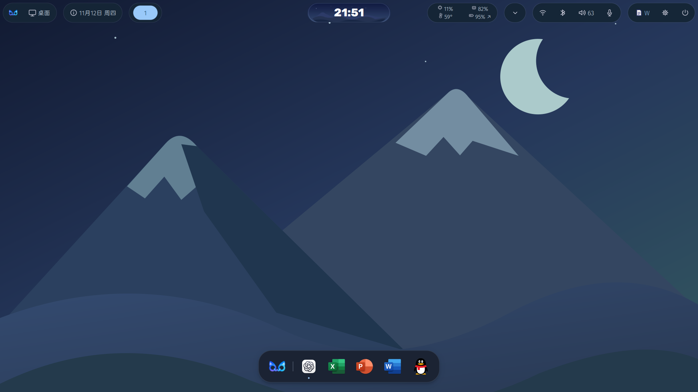

# owoDE · owo Desktop Environment

**owoDE is preparing for its first prerelease.**

A Linux / Wayland desktop built with Qt 6, QML and KWin: floating capsule panels,
a compact Dock, a landscape clock that follows local time, and wallpaper-based colors.

[中文](README.md) · [CNB](https://cnb.cool/ColoMovo-lab/owo_desktop_envirment_owoDE) ·
[GitHub](https://github.com/ColoMovo-Labs/klde)

*Desktop screenshot supplied by the project owner, November 12, 2026.*

The development branch includes native application and window switching, notifications,
system services, display scaling with automatic rollback, scheduled light/dark themes,
and a configurable lock-screen clock. Optional applications include Files and the
high-precision/programmer calculator. The offline handwriting calculator has its own development entry.

The Dock keeps minimized applications available: click to restore a single window,
or choose a window when an application has several. Its launcher logo is customizable.

Current installation validation targets Debian 13 / KWin 6.3, with Ubuntu and Fedora build paths.

- [Debian session](https://cnb.cool/ColoMovo-lab/owo_desktop_envirment_owoDE/-/blob/feat/desktop-feedback/docs/development/cutefish-debian.md)
- [Fedora session](https://cnb.cool/ColoMovo-lab/owo_desktop_envirment_owoDE/-/blob/feat/desktop-feedback/docs/development/fedora-login-session.md)
- [Prerelease acceptance](https://cnb.cool/ColoMovo-lab/owo_desktop_envirment_owoDE/-/blob/feat/desktop-feedback/docs/development/production-readiness.md)
- [Files](https://cnb.cool/ColoMovo-lab/owo_desktop_envirment_owoDE/-/blob/feat/desktop-feedback/apps/files/README.md) · [Calculator](https://cnb.cool/ColoMovo-lab/owo_desktop_envirment_owoDE/-/blob/feat/desktop-feedback/apps/calculator/README.md) · [Formula calculator](https://cnb.cool/ColoMovo-lab/owo_desktop_envirment_owoDE/-/blob/feat/desktop-feedback/apps/formula-calculator/README.md)
- [Architecture](ARCHITECTURE.md) · [Design](DESIGN.md) · [Building](README.md#开发)
- [Contributing](CONTRIBUTING.md) · [Licenses and sources](docs/legal/third-party.md)

Packages generated by CNB carry corresponding source, commit identity, checksums and test records.
The technical KLDE identifiers remain for package and source compatibility.
