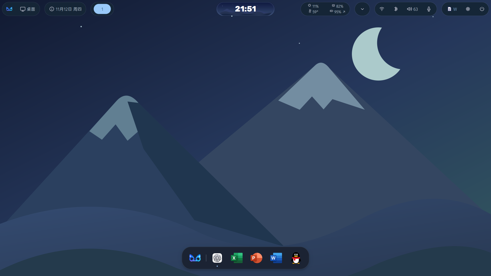

# owoDE · owo Desktop Environment

**owoDE 正在准备预发布。**

一个基于 Qt 6、QML 与 KWin 的 Linux / Wayland 桌面环境。浮动胶囊顶栏、
简洁的 Dock、随时间变化的山景时钟，以及跟随壁纸配色的深浅主题，共同组成 owoDE 的桌面体验。

[English](README.en.md) · [CNB](https://cnb.cool/ColoMovo-lab/owo_desktop_envirment_owoDE) ·
[GitHub](https://github.com/ColoMovo-Labs/klde)



*项目拥有者提供的实机截图，2026 年 11 月 12 日。*

## 桌面体验

- 原生 Wayland 顶栏与 Dock：应用启动、窗口切换、工作区、系统托盘与通知。
- Dock 保留最小化应用，单窗口点击恢复并置前，多窗口可选择要恢复的窗口；支持更换启动器 Logo。
- 时序胶囊：山景、太阳与月亮随本地时间变化；音乐、网络、音量、电源等系统状态集中展示。
- 壁纸配色与自动深浅主题，支持调整透明、模糊、动效和界面密度。
- 整体显示缩放，修改后可确认保留或自动恢复。
- 原生锁屏：日期位于时钟上方，多种时钟字体样式与本地字体导入。
- 可独立构建的应用：高精度及程序员计算器、Files 文件管理器；另有离线手写公式计算器开发版。

当前开发与安装验证以 Debian 13 / KWin 6.3 为主，保留 Ubuntu 与 Fedora 构建路径。
当前活跃开发位于 [CNB 开发分支](https://cnb.cool/ColoMovo-lab/owo_desktop_envirment_owoDE/-/tree/feat/desktop-feedback)。
预发布前的剩余工作、测试记录和安装说明见 CNB 文档；本仓库同步项目介绍与发布入口。

## 安装与应用

- [Debian 登录会话](https://cnb.cool/ColoMovo-lab/owo_desktop_envirment_owoDE/-/blob/feat/desktop-feedback/docs/development/cutefish-debian.md)
- [Fedora 登录会话](https://cnb.cool/ColoMovo-lab/owo_desktop_envirment_owoDE/-/blob/feat/desktop-feedback/docs/development/fedora-login-session.md)
- [预发布验收进度](https://cnb.cool/ColoMovo-lab/owo_desktop_envirment_owoDE/-/blob/feat/desktop-feedback/docs/development/production-readiness.md)
- [Files 文件管理器](https://cnb.cool/ColoMovo-lab/owo_desktop_envirment_owoDE/-/blob/feat/desktop-feedback/apps/files/README.md)
- [高精度与程序员计算器](https://cnb.cool/ColoMovo-lab/owo_desktop_envirment_owoDE/-/blob/feat/desktop-feedback/apps/calculator/README.md)
- [离线手写公式计算器](https://cnb.cool/ColoMovo-lab/owo_desktop_envirment_owoDE/-/blob/feat/desktop-feedback/apps/formula-calculator/README.md)

预发布安装包通过 CNB 流水线生成，并附对应源码、提交编号、校验值与测试记录。
`KLDE`、`klde-shell` 和 `org.klde.*` 保留为源码与包的兼容标识。

## 设计与架构

QML 界面 → Qt 模型与控制器 → 系统服务与 KWin 适配。

[总体架构](ARCHITECTURE.md) · [设计语言](DESIGN.md) ·
[Monet 配色](docs/design/monet-palette.md) · [路线图](ROADMAP.md) ·
[窗口管理](docs/architecture/window-management.md) · [第三方来源](docs/legal/third-party.md)

## 开发

CircleCI 是权威环境；本地主要用于编辑、审阅和提交。云端构建使用 Ubuntu 26.04
和 Fedora 44 的系统 Qt，不把本地笔记本性能当作运行时性能指标。

```sh
# 这些命令用于已配置的云端构建环境
cmake --preset ci
cmake --build --preset ci
ctest --preset ci

# 使用云端构建出的安装文件运行普通预览
klde-shell

# Fedora / KWin 目标机上显式请求原生表面（缺少 LayerShellQt 时会安全失败）
klde-shell --native-shell-surfaces
```

普通预览不会注册登录会话，也不会替换现有面板。真实会话启动和清理说明见
[CircleCI 工作流](docs/development/circleci.md)、[Fedora 运行时](docs/development/fedora-runtime.md)
和 [Real Session 0.2](docs/development/real-session-02.md)。

### Fedora 云端安装包

Fedora 版本由 CircleCI 的 `fedora-build` 在云端构建，不需要在本机编译。
打开成功流水线的 `core → fedora-build → Artifacts`，下载
`artifacts/fedora-package/` 下的 `klde-shell-preview-*.rpm`、匹配的
`owode-shell-fedora44-*.tar.gz`、`SHA256SUMS` 和 manifest。Fedora 44 上优先安装 RPM：

```sh
sudo dnf install ./klde-shell-preview-*.rpm
```

如果需要无 root 的用户安装，则解压 tarball：

```sh
mkdir -p "$HOME/.local"
tar -xzf owode-shell-fedora44-*.tar.gz -C "$HOME/.local" --strip-components=1
"$HOME/.local/bin/klde-shell"
```

这是独立预览窗口，不会替换当前桌面。若要测试嵌套 KWin 原生表面，需使用
匹配提交中的 `tools/run-owode-session.sh`，并设置 `OWODE_MODE=native`；
它仍然不会安装登录会话。Fedora 目前提供云端 RPM 和 tarball，另提供实验性的可选登录会话包，参见上方会话指南。

## 贡献与许可

请先阅读 [CONTRIBUTING.md](CONTRIBUTING.md)、[CODE_OF_CONDUCT.md](CODE_OF_CONDUCT.md)
和 [SECURITY.md](SECURITY.md)。代码和构建配置使用 **GPL-3.0-or-later**；原创
文档与艺术资源默认使用 **CC BY-SA 4.0**。第三方代码和资源保留其原始许可，
来源记录见 [docs/legal/third-party.md](docs/legal/third-party.md)。

owoDE 与 GitHub 上的 `ColoMovo-Labs/klde`、CNB 上的
`ColoMovo-lab/owo_desktop_envirment_owoDE` 是同一项目的两个公开代码托管位置。
GitHub 和 CircleCI 继续保留；CNB 镜像不会替换 CircleCI 的权威检查。

项目与 Canonical、Ubuntu Kylin、Kylinsoft、KDE、GNOME、Google、Apple、Microsoft
或其他灵感来源没有隶属、赞助或商标授权关系。

## Visual Workspace · 可视化工作区

首个计划版本：**v0.0.1 Alpha · YunShuang（云霜）**。现有开发包的技术版本不是正式发布承诺。

在 Qt Design Studio 打开 [`design/owoDE.qmlproject`](design/owoDE.qmlproject)。
桌面、背景、Ribbon、Dock、启动器、快捷设置、通知、锁屏视觉、语言/欢迎页、设置与窗口/OSD 可分别选择。
[`中文操作与兼容性说明`](docs/development/visual-workspace.md)解释共享组件、保存与云端验收。

### WowType 输入法适配准备

系统会话通过 Fcitx5 控制器读取真实分组并回读确认切换；Visual Lab 保留模拟选择器。
WowType 作为可选的独立 Fcitx5 插件接入，提供设置入口与只读诊断，不会自动安装、
重启输入法或改动用户主题。详见 [WowType 接入与验收](docs/architecture/wowtype.md)。
