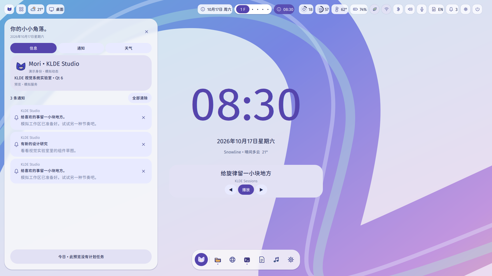

# owoDE（技术仓库名：KLDE）

**owoDE** 的正式名称是 **owo Desktop Envirment**（沿用项目确定的拼写），
中文名为 **owo 桌面环境**。这是一个面向 Linux / Wayland 的实验性开源桌面
环境，保留柔和的 Kylin 氛围、Material Expressive 式的形状与动效，以及可扩展
的浮动 / 平铺工作流。

[English README](README.en.md) · [GitHub](https://github.com/ColoMovo-Labs/klde) ·
[CNB 镜像](https://cnb.cool/ColoMovo-lab/owo_desktop_envirment_owoDE)

> **早期开发中，尚不适合日常使用。**
>
> `KLDE`、`klde-shell`、`KLDE.Shell` 和 `org.klde.*` 是保留的技术标识，
> 用于兼容已有源码、包名、CI 与迁移历史；新的用户界面品牌统一使用 owoDE。

## 愿景

owoDE 从 Ubuntu Kylin / UKUI 在 2020–2021 年前后的明亮、柔和气质出发，结合
Qt 6 / QML、现代桌面密度、表达性动效和克制的 Kemono 个性，探索一个安静时
稳定、交互时有生命力的桌面。它不是 UKUI、KDE Plasma、GNOME、macOS、Windows
或 Material Design 的换皮，也不隶属于这些项目。

第一目标平台仍是 Ubuntu Kylin / Ubuntu 26.04 LTS；Fedora 44 是当前真实
Wayland / KWin 验证平台。长期目标是保持对普通 Ubuntu 和其他 Debian 系统的
可移植性。KWin 是当前窗口管理与合成基础，但 owoDE 不会在这个阶段另写一个
合成器，也不会要求 Plasma Shell。

## 当前状态

- Qt 6 / QML / C++20 / CMake 单仓库已公开，CircleCI 负责权威构建、静态分析、
  单元测试、QML 测试、Wayland 烟雾测试和打包检查。
- Visual Lab 和 MockBackend 仍然可用，所有 mock 行为都在界面和文档中明确标注。
- Fedora 44 + niri 主机上已经完成第一次嵌套 KWin 亮相：KWin 6.7.5、真实 Qt 6
  客户端和 owoDE 预览同时显示，主机 niri 保持运行。
- LayerShellQt 原生背景、顶栏和 Dock 正在接入；没有 Fedora 目标机的协议日志
  和角色证据前，不把它们宣称为已完成。

## First Light：第一次嵌套 KWin 亮相

下面的照片是项目拥有者提供的 Fedora 44 + niri 本地证据。它证明了嵌套 KWin、
真实 Qt 应用和当前桌面预览可以共存；它是 **早期嵌套 KWin 概念验证，不是生产
级桌面环境**，也不能单独证明 LayerShellQt 的 surface role、exclusive zone 或
输入区域已经正确。


完整的边界、复现命令和待验证项见 [First Light 记录](docs/development/first-light.md)
与 [Real Session 0.1](docs/development/real-session-0.1.md)。当前安全启动器会
创建独立 D-Bus / Wayland 运行边界，绝不替换主机登录会话；历史的 `wayland-2`
和 PID 只属于那一次运行，不能写进配置。

## 视觉预览

这些是 CircleCI 中实际渲染的 Qt 预览，不代表真实系统服务状态：



[浅色 / 中文标准](docs/previews/baseline-light-zh-standard.png) ·
[浅色 / 中文可爱语音](docs/previews/baseline-light-zh-cute.png) ·
[深色 / 中文可爱语音](docs/previews/baseline-dark-zh-cute.png) ·
[Temporal v2 研究记录](docs/previews/temporal-v2/README.md) ·
[渲染来源与验收流程](docs/previews/README.md)

## 架构

```
QML presentation
        ↓
Qt models/controllers
        ↓
system and compositor adapters
```

当前代码分为 `qml`、`src/shell`、`src/models`、`src/backends` 和
`src/platform` 的职责边界。KWin / LayerShellQt 集成通过可选的原生表面控制器
进入；LayerShellQt 不存在时，普通预览路径仍然可构建。窗口布局继续保留
Floating、Classic Tiling、Scrolling Tiling 和 Mixed 的抽象，但高级平铺尚未实现。

重点文档：

- [总体架构](ARCHITECTURE.md)
- [设计语言](DESIGN.md)
- [Monet 色彩系统](docs/design/monet-palette.md)
- [路线图](ROADMAP.md)
- [KWin 适配边界](docs/architecture/kwin-adapter.md)
- [Linux 后端边界](docs/architecture/linux-backend.md)
- [窗口管理愿景](docs/architecture/window-management.md)
- [LayerShellQt / 原生表面记录](docs/development/real-session-02.md)

## 开发

CircleCI 是权威环境；本地主要用于编辑、审阅和提交。云端构建使用 Ubuntu 26.04
和 Fedora 44 的系统 Qt，不把本地笔记本性能当作运行时性能指标。

```sh
# 这些命令用于已配置的云端构建环境
cmake --preset ci
cmake --build --preset ci
ctest --preset ci

# 使用云端构建出的安装文件运行普通预览
klde-shell

# Fedora / KWin 目标机上显式请求原生表面（缺少 LayerShellQt 时会安全失败）
klde-shell --native-shell-surfaces
```

普通预览不会注册登录会话，也不会替换现有面板。真实会话启动和清理说明见
[CircleCI 工作流](docs/development/circleci.md)、[Fedora 运行时](docs/development/fedora-runtime.md)
和 [Real Session 0.2](docs/development/real-session-02.md)。

### Fedora 云端安装包

Fedora 版本由 CircleCI 的 `fedora-build` 在云端构建，不需要在本机编译。
打开成功流水线的 `core → fedora-build → Artifacts`，下载
`artifacts/fedora-package/` 下的 `klde-shell-preview-*.rpm`、匹配的
`owode-shell-fedora44-*.tar.gz`、`SHA256SUMS` 和 manifest。Fedora 44 上优先安装 RPM：

```sh
sudo dnf install ./klde-shell-preview-*.rpm
```

如果需要无 root 的用户安装，则解压 tarball：

```sh
mkdir -p "$HOME/.local"
tar -xzf owode-shell-fedora44-*.tar.gz -C "$HOME/.local" --strip-components=1
"$HOME/.local/bin/klde-shell"
```

这是独立预览窗口，不会替换当前桌面。若要测试嵌套 KWin 原生表面，需使用
匹配提交中的 `tools/run-owode-session.sh`，并设置 `OWODE_MODE=native`；
它仍然不会安装登录会话。Fedora 目前提供云端 RPM 和 tarball，尚未提供完整登录会话包。

## 贡献与许可

请先阅读 [CONTRIBUTING.md](CONTRIBUTING.md)、[CODE_OF_CONDUCT.md](CODE_OF_CONDUCT.md)
和 [SECURITY.md](SECURITY.md)。代码和构建配置使用 **GPL-3.0-or-later**；原创
文档与艺术资源默认使用 **CC BY-SA 4.0**。第三方代码和资源保留其原始许可，
来源记录见 [docs/legal/third-party.md](docs/legal/third-party.md)。

owoDE 与 GitHub 上的 `ColoMovo-Labs/klde`、CNB 上的
`ColoMovo-lab/owo_desktop_envirment_owoDE` 是同一项目的两个公开代码托管位置。
GitHub 和 CircleCI 继续保留；CNB 镜像不会替换 CircleCI 的权威检查。

项目与 Canonical、Ubuntu Kylin、Kylinsoft、KDE、GNOME、Google、Apple、Microsoft
或其他灵感来源没有隶属、赞助或商标授权关系。
