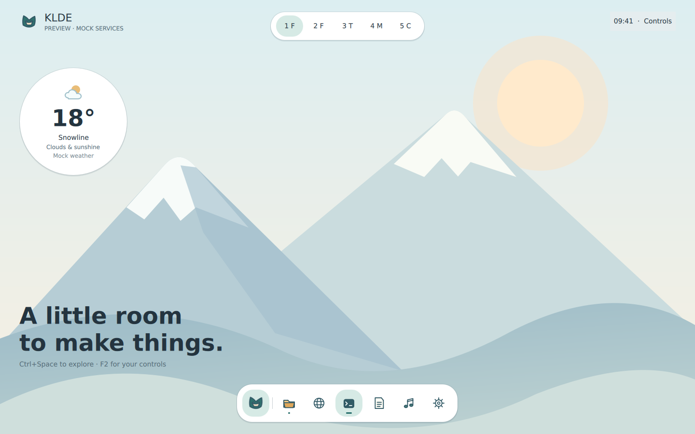

# Kemono Linux Desktop Environment

**KLDE** is an experimental open-source Linux desktop environment inspired by
the visual spirit of early UKUI/Kylin desktops, modern expressive UI design,
and a flexible floating/tiling workflow.

**Early development. Not ready for daily use.** The initial target is Ubuntu
Kylin / Ubuntu 26.04 LTS. The shell uses Qt 6, QML / Qt Quick, C++20 and CMake.

## Vision

What if the bright, soft desktop atmosphere of Kylin around 2020–2021 had
evolved along its own path? KLDE explores that direction through calm floating
surfaces, expressive interactions, restrained Kemono character and a desktop
that supports both floating and tiled workspaces.

KLDE develops an independent shell. Ubuntu Kylin is the first host environment;
UKUI is a possible compatibility layer, not the implementation we reskin.
Normal Ubuntu and, later, other Debian-based distributions remain portability
targets. We are not building or forking a compositor in this phase.

## Status

Phase 0 provides project documents, contribution templates, a CircleCI configuration,
a minimal `klde-shell` test window and initial startup tests. All six CircleCI jobs
passed for baseline `418ea56`. See [the handoff](docs/development/phase-0.md).

The Phase 1 feature branch adds the dock, search launcher, quick settings,
weather widget, workspace indicator and a bounded owned-content blur laboratory.
It uses C++ mock backends; feature cloud validation is pending. See
[the prototype guide](docs/development/phase-1.md) for controls and validation.
There are no real service integrations, desktop-session replacement, telemetry,
weather requests, or privileged helpers.

## Screenshots / Concept Art

Actual Phase 1 preview rendered by CircleCI with Mesa llvmpipe at `472c921`.
This is a runnable Qt window using mock data, not concept art or a complete desktop session:



No concept image was supplied. Future concept images belong under
`docs/concepts/klde-concept-01.*` and must be labelled “Early concept — not final UI.”
The earlier [Phase 0 capture](docs/development/foundation-llvmpipe.png) is retained
with its [baseline validation record](docs/development/phase-0.md). Software CI
captures verify rendering correctness; representative GPU performance is measured
separately on real hardware.

## Architecture

QML presentation → Qt models/controllers → system and compositor adapters.
The shell owns its UI; existing system services and compositors retain their
responsibilities. Start with [ARCHITECTURE.md](ARCHITECTURE.md),
[DESIGN.md](DESIGN.md), [ROADMAP.md](ROADMAP.md) and the
[decision records](docs/decisions/).

## Development

CircleCI is the authoritative configure, build, analysis and test environment.
Local work is primarily editing, reviewing and committing; local compilation
is not required. The baseline requires Qt **6.8 or newer** and CMake 3.25+.
Ubuntu 26.04's packaged Qt is used by CI rather than a private Qt SDK.

```sh
# These build commands are intended for the cloud job.
cmake --preset ci
cmake --build --preset ci
ctest --preset ci

# After obtaining a compatible cloud-built installation:
klde-shell
```

The installed application opens a regular window alongside the current desktop.
It does not register a login session or replace existing panels.
See [development setup](docs/development/circleci.md).

## CircleCI

[`.circleci/config.yml`](.circleci/config.yml) defines configure/build, static
analysis, Qt Test, QML tests, nested/headless smoke tests and a packaging check.
No GitHub Actions build is used. Connecting the repository and enabling triggers
are separate administrative steps; a configuration file alone does not activate CI.
See [cloud setup and required checks](docs/development/circleci.md).

## Contributing

Read [CONTRIBUTING.md](CONTRIBUTING.md), [CODE_OF_CONDUCT.md](CODE_OF_CONDUCT.md)
and [SECURITY.md](SECURITY.md). Small, reviewable changes and honest validation
reports matter. Distinguish proposed design, mock behavior, cloud-tested behavior
and measurements on real hardware.

## License

Original code and build/tooling configuration: **GPL-3.0-or-later**.
Documentation and original artwork: **CC BY-SA 4.0**, unless individually
marked otherwise. See [LICENSE](LICENSE), [REUSE.toml](REUSE.toml),
[license texts](LICENSES/) and [dependency provenance](docs/legal/third-party.md).
Third-party dependencies keep their own licenses.

KLDE is independent and is not affiliated with or endorsed by Canonical,
Ubuntu Kylin, Kylinsoft, Google, KDE, GNOME, Microsoft, Apple, or the other
projects referenced as inspiration. Names and visual references do not imply
affiliation or permission to use their trademarks.
