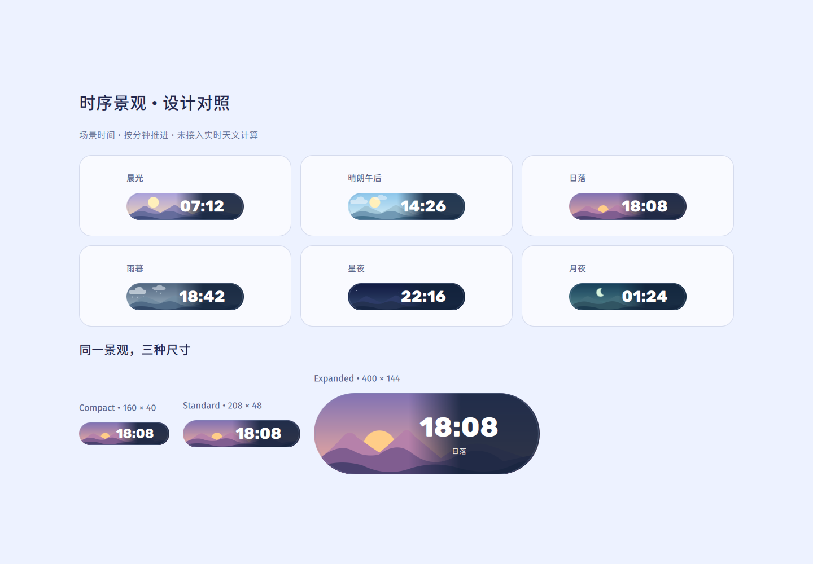

# KLDE (provisional codename)

**KLDE** is an experimental open-source Linux desktop environment inspired by
the visual spirit of early UKUI/Kylin desktops, modern expressive UI design,
and a flexible floating/tiling workflow.

**Early development. Not ready for daily use.** The initial target is Ubuntu
Kylin / Ubuntu 26.04 LTS. The shell uses Qt 6, QML / Qt Quick, C++20 and CMake.

## Vision

We started KLDE because we wanted a beautiful, expressive and comfortable Linux
desktop and could not find exactly the combination we wanted. The name is
**Kemono Linux Desktop Environment**. Why not “Kemono Desktop Environment”?
That would abbreviate to KDE and create unnecessary confusion with KDE Plasma
and KDE e.V.; this independent project deliberately uses **KLDE**.

Ubuntu Kylin / Ubuntu 26.04 LTS is the first-class target. Fedora is a serious
secondary platform, with source portability and future RPM support. Arch,
EndeavourOS, CachyOS and other distributions may build from source; official
packages and support are not implied. See the [platform policy](docs/development/platforms.md).

An eventual Ubuntu LTS-based distribution may select KLDE, applications and
opinionated defaults. That distribution is a downstream product: KLDE must remain
independently installable and must not depend on its ISO, branding or update policy.
The future distribution's name is not settled.

What if the bright, soft desktop atmosphere of Kylin around 2020–2021 had
evolved along its own path? KLDE explores that direction through calm floating
surfaces, expressive interactions, restrained Kemono character and a desktop
that supports both floating and tiled workspaces.

KLDE develops an independent shell. Ubuntu Kylin is the first host environment;
UKUI is a possible compatibility layer, not the implementation we reskin.
Normal Ubuntu and, later, other Debian-based distributions remain portability
targets. We are not building or forking a compositor in this phase.

## Status

Phase 0 provides project documents, contribution templates, a CircleCI configuration,
a minimal `klde-shell` test window and initial startup tests. All six CircleCI jobs
passed for baseline `418ea56`. See [the handoff](docs/development/phase-0.md).

The Phase 1 feature branch adds a coherent shell preview, expressive controls,
editable Power Scenes, owned-wallpaper blur, session shortcuts and bilingual
language/voice/input models. Current development and eight-job cloud acceptance
are tracked in [PR #1](https://github.com/ColoMovo-Labs/klde/pull/1). See the
[prototype guide](docs/development/phase-1.md) and
[latest rendering evidence](docs/development/expressive-language.md).

The stacked [Visual System Lab change](https://github.com/ColoMovo-Labs/klde/pull/2)
adds structured scenarios, configurable floating status islands, three density
modes, notifications, owned candidate UI, optional ambient layout, original
wallpapers and the opt-in Mock Lab. See the [usage and acceptance guide](docs/development/visual-lab.md)
and [pinned component reuse audit](docs/reuse/component-audit.md).

System controls, workspace management and input selection remain mock. The
experimental weather adapter is disabled by default and requires an explicitly
entered city and online consent. There is no telemetry or privileged helper.

The current [temporal-axis pass](docs/design/temporal-capsule.md) groups the
ribbon, adds a dedicated display clock and defines cached wallpaper effects and
optional Android sources. See [layout](docs/design/top-ribbon-layout.md),
[wallpaper pipeline](docs/design/wallpaper-depth.md),
[provider contracts](docs/architecture/mock-backends.md) and the
[temporal v2 implementation record](docs/development/temporal-v2.md).

## Screenshots / Concept Art

Actual Visual System Lab window rendered in CircleCI at `752af8c8f36b` using
Mesa llvmpipe. All system state is mock; this is a runnable Qt preview.


[Light / Chinese Standard](docs/previews/baseline-light-zh-standard.png) ·
[Light / Chinese Cute](docs/previews/baseline-light-zh-cute.png) ·
[Dark / Chinese Cute](docs/previews/baseline-dark-zh-cute.png) ·
[Dense ribbon](docs/previews/baseline-dense-ribbon.png) ·
[Quick Settings](docs/previews/baseline-quick-settings.png) ·
[Language & Input](docs/previews/baseline-language-input.png) ·
[Rendering provenance and review procedure](docs/previews/README.md).

### Temporal v2 visual study

These actual Qt captures were rendered by CircleCI pipeline 50 from source
`775d728`. They show the six landscape states, the three capsule sizes, the
night palette, the centered ribbon crop and the focus clock mode. Mock data is
explicitly disclosed in the [evidence record](docs/previews/temporal-v2/README.md).



[Night desktop](docs/previews/temporal-v2/night-desktop.png) ·
[Narrow desktop](docs/previews/temporal-v2/axis-narrow.png) ·
[Ribbon crop](docs/previews/temporal-v2/ribbon-detail.png) ·
[Expanded capsule](docs/previews/temporal-v2/temporal-expanded.png) ·
[Focus clock](docs/previews/temporal-v2/focus-desktop.png)

Earlier Phase 1 captures remain in the [expressive preview record](docs/development/expressive-language.md)
and [prototype guide](docs/development/phase-1.md).

The owner supplied a colorful desktop screenshot as a visual reference on
17 October 2026. Its third-party logos and wallpaper are not redistributed here;
[the Expressive study](docs/design/reference-study.md) and
[the dense desktop study](docs/design/reference-study-visual-lab.md) record the
design direction.
Published preview captures use original KLDE assets and identify the tested revision.
The earlier [Phase 0 capture](docs/development/foundation-llvmpipe.png) is retained
with its [baseline validation record](docs/development/phase-0.md). Software CI
captures verify rendering correctness; representative GPU performance is measured
separately on real hardware.

## Architecture

QML presentation → Qt models/controllers → system and compositor adapters.
The shell owns its UI; existing system services and compositors retain their
responsibilities. Start with [ARCHITECTURE.md](ARCHITECTURE.md),
[DESIGN.md](DESIGN.md), [ROADMAP.md](ROADMAP.md) and the
[decision records](docs/decisions/).

The display strategy is **Wayland first, X11 compatible**, using Qt QPA for the
ordinary preview window. English and Simplified Chinese have separate Standard
and optional Cute voice layers. The input prototype detects Fcitx 5 availability
and offers a clearly labelled mock selector; it does not control the host IME.
See [display protocols](docs/architecture/display-protocols.md),
[localization](docs/architecture/i18n.md) and [input methods](docs/architecture/input-methods.md).

## Development

CircleCI is the authoritative configure, build, analysis and test environment.
Local work is primarily editing, reviewing and committing; local compilation
is not required. The baseline requires Qt **6.8 or newer** and CMake 3.25+.
Ubuntu 26.04's packaged Qt is used by CI rather than a private Qt SDK.

```sh
# These build commands are intended for the cloud job.
cmake --preset ci
cmake --build --preset ci
ctest --preset ci

# After obtaining a compatible cloud-built installation:
klde-shell
```

The installed application opens a regular window alongside the current desktop.
It does not register a login session or replace existing panels.
See [development setup](docs/development/circleci.md).

## CircleCI

[`.circleci/config.yml`](.circleci/config.yml) defines configure/build, static
analysis, Qt Test, QML tests, Wayland/XCB smoke tests, an independent Fedora build,
actual Debian packaging and clean runtime install/removal checks. Catalog and
voice validation run with static analysis.
No GitHub Actions build is used. Connecting the repository and enabling triggers
are separate administrative steps; a configuration file alone does not activate CI.
See [cloud setup and required checks](docs/development/circleci.md).

## Contributing

Read [CONTRIBUTING.md](CONTRIBUTING.md), [CODE_OF_CONDUCT.md](CODE_OF_CONDUCT.md)
and [SECURITY.md](SECURITY.md). Small, reviewable changes and honest validation
reports matter. Distinguish proposed design, mock behavior, cloud-tested behavior
and measurements on real hardware.

## License

Original code and build/tooling configuration: **GPL-3.0-or-later**.
Documentation and original artwork: **CC BY-SA 4.0**, unless individually
marked otherwise. See [LICENSE](LICENSE), [REUSE.toml](REUSE.toml),
[license texts](LICENSES/) and [dependency provenance](docs/legal/third-party.md).
Third-party dependencies keep their own licenses.

KLDE is independent and is not affiliated with or endorsed by Canonical,
Ubuntu Kylin, Kylinsoft, Google, KDE, GNOME, Microsoft, Apple, or the other
projects referenced as inspiration. Names and visual references do not imply
affiliation or permission to use their trademarks.
