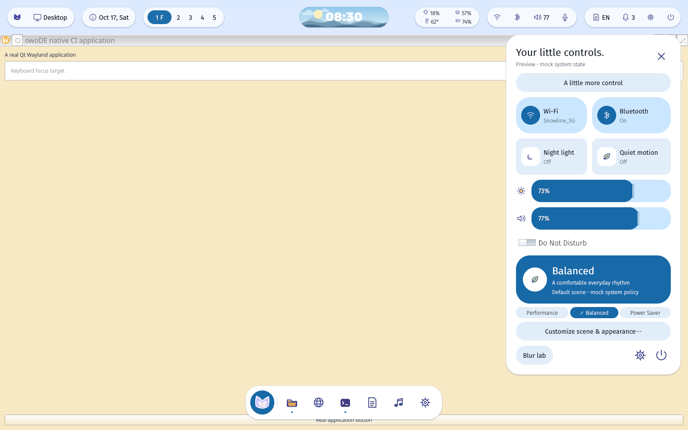

# Fedora native session gate — CircleCI 122 / job 992

Verified source: `3ec750bf4c2d67cc936c766fe83ad18ae01a3091`.
[Cloud job](https://app.circleci.com/pipelines/circleci/3oxaeukVqAvAfF4HxntS1j/LfN9QA8DUhSreeQV9xNCMg/122/workflows/5d46ca6e-989e-4325-b4bb-d16059b4495b/jobs/992).
Fedora 44, KWin 6.7.5, private Xvfb output 1600×1000, QPainter compositor.

All native assertions passed: real layer-shell roles and geometry, reserved top
space, application maximization, actual transparent-gap clicks, Dock launcher,
keyboard search, Escape/outside dismissal, focus restoration, quick settings,
modifier drag, normal client close and shell survival. The actual CLI also
created four configured layer surfaces and no ordinary application toplevel.
KWin handled SIGTERM (status 15), exited and removed its private socket.

The system state/application catalogue remain mock. The PNG sidecar records
PID-verified private X11 viewport capture for the QPainter renderer. This is
single-output software correctness evidence, not hardware GPU, portal, real
system-service or daily-use acceptance. It does not replace owner-host testing.
Raw compressed Wayland logs, JUnit, KWin snapshots and shutdown evidence are
included; SHA256SUMS covers the machine-generated artifacts, not this README.
