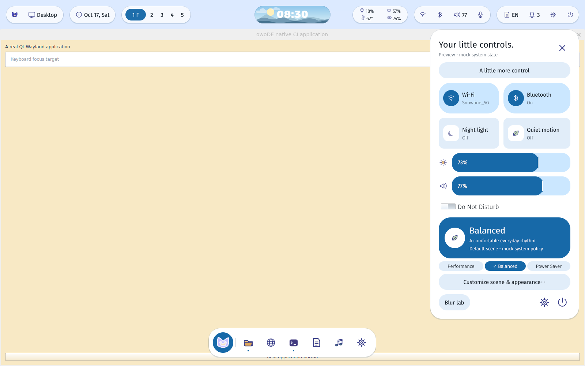

# Ubuntu native session gate — CircleCI 120 / job 976

Verified source: `b0ae620a052524e27b408ccf7a99cc4ed0da5297`.
[Cloud job](https://app.circleci.com/pipelines/circleci/3oxaeukVqAvAfF4HxntS1j/LfN9QA8DUhSreeQV9xNCMg/120/workflows/69f7edf5-429e-47fa-b73c-42df3b385623/jobs/976).
Ubuntu 26.04, KWin 6.6.6, private Xvfb output 1600×1000, QPainter compositor.

The complete isolated native test passed (3 Qt Test functions, zero failures or
skips). Assertions cover Desktop/Dock roles and geometry, reserved ribbon space,
maximized application size, actual clicks through transparent regions, actual
Dock launcher invocation, typed search, Escape and outside dismissal, keyboard
focus restoration, quick settings placement, modifier drag, normal application
close, and shell survival. The actual shell CLI also created four layer-shell
roles with configure acknowledgements and no ordinary application toplevel.

These are real protocol, geometry and input checks with a separate Qt Wayland
application. System control values and application catalogue are still mock.
The screenshot's sidecar identifies the PID-verified private X11 viewport
transport; it is not an OpenGL/GPU benchmark. Normal termination records KWin's
handled SIGTERM status 15 and removal of its private socket. No host session was
changed. No local compilation was performed.

Raw Wayland client logs are gzip-compressed without editing. JSON snapshots,
JUnit XML, versions and shutdown evidence accompany them. SHA256SUMS covers the
original machine-generated artifacts (this explanatory README is separate).
This accepts a single-output Ubuntu cloud integration gate, not Fedora host,
multi-output, hardware rendering, lock security or daily-use readiness.
