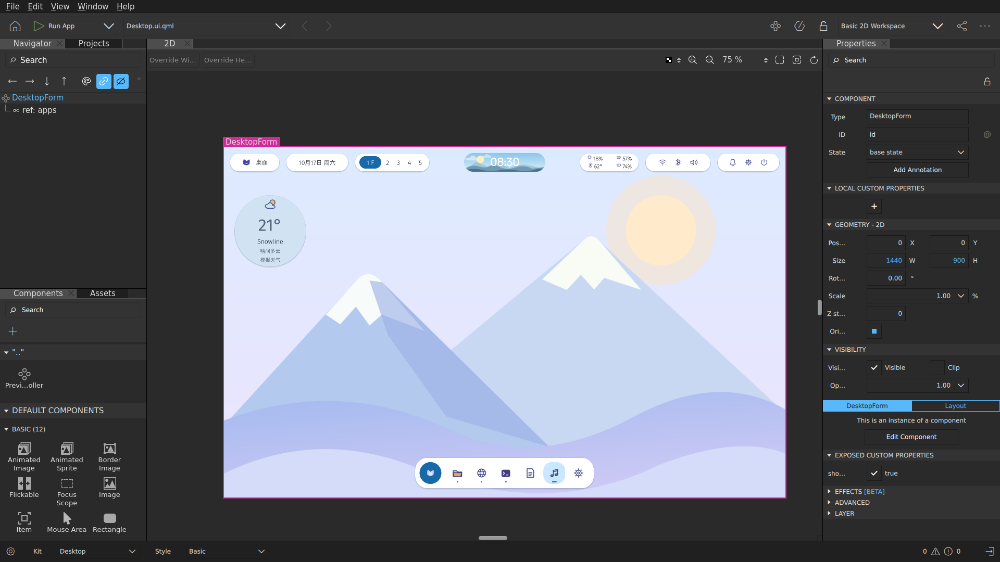
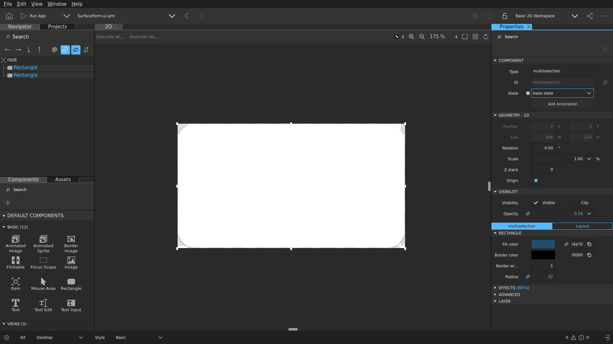
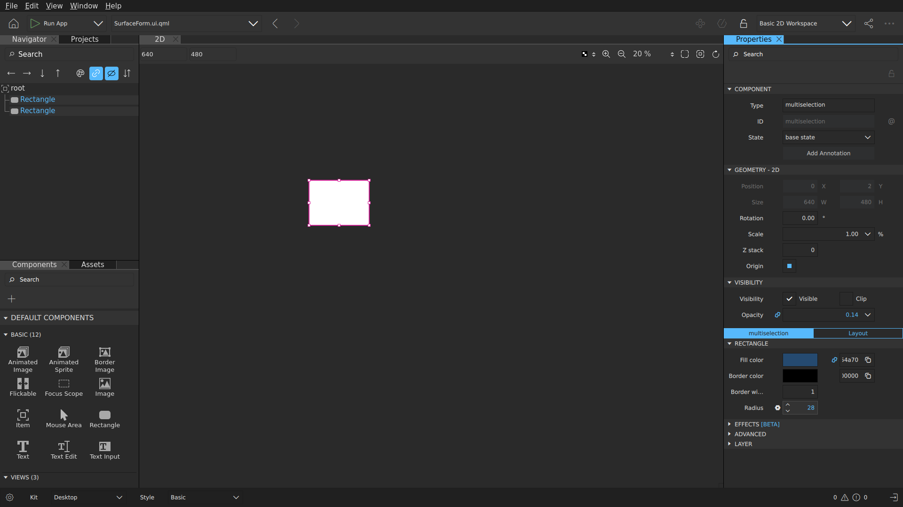

# Qt Design Studio 实体编辑验收

客户端日期：2026-10-25。环境：Fedora 44 + 受保护的 niri 会话。
Qt Design Studio **4.8.2**，基于 **Qt 6.10.3**；Flatpak ID `io.qt.qtdesignstudio`，
Flathub 系统安装 commit `13a15c60641b30d778fb5a8c15695b61cab71a52c70fe5ad0b73c5fde5a8e349`。

这是实际运行的 Qt Design Studio 窗口截图，不是界面概念图。

已验证：

- 打开 `design/owoDE.qmlproject`，2D 桌面、原有壁纸/图标、Navigator 和 Properties 可用。
- 从共享 `SurfaceForm.ui.qml` 打开组件；显式模块 import 后，单独编辑时令牌宽高为 408×224。
- 使用鼠标在 Properties 中把两个 Rectangle 的 radius 从绑定改成 28。
- 使用 Qt Design Studio 的 Save，随后实际源文件出现两处 `radius: 28`。
- 使用 Qt Design Studio 的 Undo 和 Save 撤销验收修改；正式组件保留令牌绑定。
- 正式运行时的 `qml/components/Surface.qml` 使用这个共享表单。

本机没有执行 CMake/C++ 编译，没有替换 niri 或修改默认登录会话，也没有操作浏览器。
早期验收曾使用两个独立 `-settingspath`，导致本机工程配置的 EnvironmentId 与普通启动环境不一致，
触发用户报告的 **No valid settings file could be found**。旧 `.qmlproject.qtds*` 已移到工作区的
`work/qds-settings-backup/` 保留，日常入口统一使用默认配置。该本机配置不提交到仓库。
已使用默认设置重新打开同一工程，未出现设置警告，2D 画布显示完整 1440×900 桌面。
Qt Design Studio 自身的初始化/缩略图诊断不等于 shell 的运行时诊断。

自动化部分另由 CircleCI 的 `designer-compat`（Qt Creator 的 QML Designer renderer）
和独立后端的 `design-workspace` Qt Test 覆盖 13 个场景。它们证明各自覆盖的加载、渲染或交互；
不能据此宣称已完成日常桌面、认证锁屏、全部系统服务或所有设计器版本兼容性。
