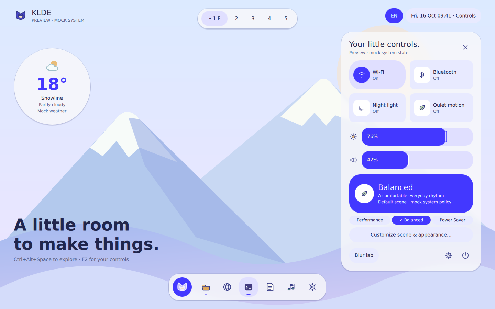

# Expressive, language and input preview

These are actual Qt Quick window captures, rendered by CircleCI integration job
152 at source `833d34ab2d6671e01feb5d9ef12f53e22ee171ad` in
[pipeline 23](https://app.circleci.com/pipelines/circleci/3oxaeukVqAvAfF4HxntS1j/9f38edc2-e2b3-4a5a-b510-656e0f838973/23/details?useNewPipelines=true&workflowId=2123f536-f9fc-4935-96fe-621f8ae67a23).
The images were visually inspected, not fabricated from a concept. The complete
current-head CI result is recorded in [PR #1](https://github.com/ColoMovo-Labs/klde/pull/1);
rendering evidence here is scoped to the identified jobs and revision.

[Desktop](expressive-desktop.png) · [Launcher](expressive-launcher.png) ·
[Dark controls](expressive-dark.png) · [Chinese Standard](expressive-zh-cn.png) ·
[Chinese Cute](expressive-zh-cn-cute.png) · [Language & Input](expressive-language.png) ·
[Input selector](expressive-input.png) · [Scene preferences](expressive-scenes.png) ·
[Owned blur laboratory](expressive-blur.png).

## Implemented behavior

The revised component language uses saturated indigo emphasis, circular tile
icons, thick value bars with contrasting foreground ink, selected scene surfaces,
capsule actions and finite shape transitions. Wallpaper/icons are original KLDE
SVG assets. The supplied desktop reference informed hierarchy and control weight;
none of its wallpaper, application logos or windows are redistributed.

The current catalogs provide 194 bilingual stable message IDs and four optional Cute overrides
per locale. Locale and voice are independent session choices; no OS locale is
created or changed. Missing Cute entries use Standard. Runtime and CI prevent
voice overrides in security/privacy/legal/destructive and other protected
namespaces. Chinese labels, mock date formatting, CJK fonts and basic Chinese/
manual Pinyin search aliases are present. Real XDG app discovery is later work.

Language & Input settings, the EN/拼 mock selector and read-only Fcitx 5 service
detection are connected through C++ models. The input text area follows the
host's Qt input context. Original light/dark Fcitx Classic UI themes are packaged
but not selected automatically. Actual engine switching, native candidates, theme
rendering/latency and Power Scene appearance synchronization are not validated.

## Cloud evidence

- Ubuntu 26.04 / Qt 6.10.2 and Fedora 44 / Qt 6.11.2 compile the preview.
- Unit/startup tests cover locale/voice isolation, fallback, critical tone locks,
  normalized weather conditions, unsupported real input control and CJK glyphs.
- The same Qt Quick suite passes under Weston/Wayland and Xvfb/XCB: 13 checks
  passed per path, including launcher interaction, semantic primary contrast
  across light/dark accent presets and keyboard language/voice selection.
- All twelve audited integration scenes submit **0 frames** in the controlled
  settled one-second observation: desktop, controls, launcher, blur, scenes,
  weather, language, input, dark, Chinese Standard, Chinese Cute and English Cute.
- Package job 153 creates a real `.deb`, matching Git source archive and checksums.
  Fresh-container job 154 resolves only declared runtime dependencies, checks
  license files and absence of Qt development packages, captures the installed
  English/Chinese preview and blur scene, verifies theme files and purges the
  package. Its cold blur audit also reports 0 frames.

The diagnostic waits at least 700 ms and then 300 ms without a submitted frame
before the unchanged one-second audit; continuous rendering fails its overall
12-second timeout. Software rendering and llvmpipe establish correctness, not
Intel/AMD/NVIDIA performance or desktop power consumption. Local compilation,
tests and analysis were not used as acceptance evidence.

The shell is still an ordinary preview window with mock system/workspace/input
controls, not an installed desktop session. Optional weather is disabled by
default; fixture tests do not prove live-provider acceptance. Native compositor
blur, global shortcuts, persistent preferences, broad accessibility, interactive
IME/XWayland compatibility and representative hardware review remain future work.
