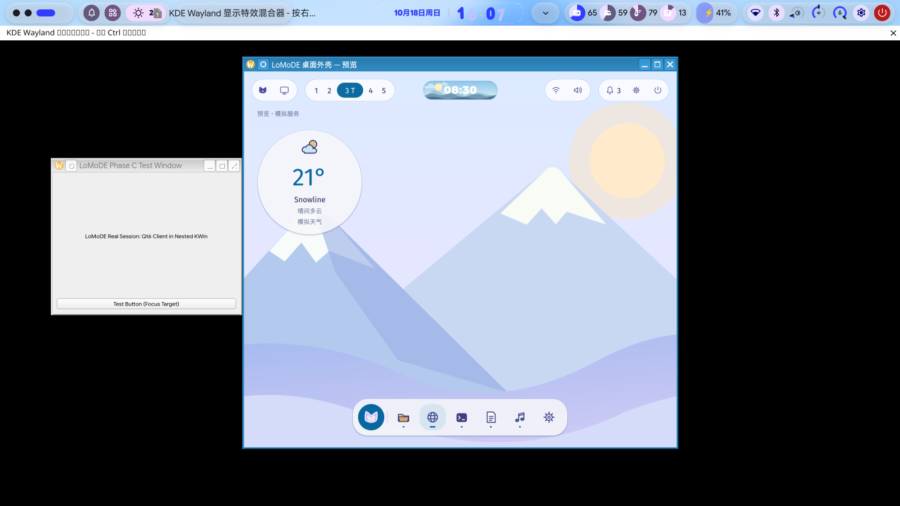

# owoDE First Light

This record preserves the first visible local runtime milestone for the
owoDE shell.

## What was demonstrated

The project owner supplied a native-resolution screenshot from Fedora 44 with
niri as the protected host compositor and a nested KWin Wayland session. The
session showed the current owoDE desktop preview together with a genuine Qt 6
test application. The captured image is 1918 × 1078 RGB PNG:



This is an **early nested KWin proof of concept**, not a production desktop
environment. The preview is still an ordinary Qt application window at this
checkpoint. The screenshot is visual evidence of a working nested runtime and
client coexistence; it is not evidence that owoDE already owns native
wallpaper, panel, dock or layer-shell roles.

## Reproduction boundary

The safe runner remains:

```sh
LOMODE_SHELL=/path/to/klde-shell \
LOMODE_APP='your-real-wayland-application' \
bash tools/run-lomode-session.sh
```

The runner creates a private session bus, uses a private Wayland socket and
cleans up only the nested processes. It does not replace the host compositor,
edit the display-manager session or require Plasma Shell. The read-only probe
is:

```sh
bash tools/probe-real-session.sh
```

The exact KWin command line, package versions and process/protocol logs for the
owner-supplied photograph were not included with the image. They remain to be
collected alongside the native-surface test so the result is reproducible.

## Verification status

| Claim | Status |
| --- | --- |
| Nested KWin is visible with owoDE preview | owner-supplied photographic evidence |
| Genuine Qt 6 client is visible alongside the preview | owner-supplied photographic evidence |
| Host niri session remains protected | runner design and user report; target-run log pending |
| Wallpaper is a native background surface | not yet verified |
| Ribbon is an anchored layer-shell surface | not yet verified |
| Dock is an anchored layer-shell surface | not yet verified |
| Focus, maximization, exclusive zones and popup positioning | not yet verified |

CircleCI and the Visual Lab remain the authoritative mock/CI path while the
native-surface milestone is brought up on a Fedora/KWin runtime.
